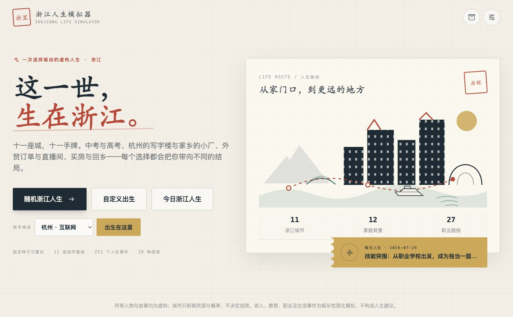

# Zhejiang Life Simulator · 浙江人生模拟器

[简体中文](README.zh-CN.md) · [Live demo](https://zhejiang-life-simulator.vercel.app)

A seedable, choice-driven life simulation game about cities, industries, migration, and everyday life in Zhejiang, China.



## At a glance

| Content | Scale |
| --- | ---: |
| Life events | 251 registered events: 246 original narrative events plus 5 release-quality balance and recovery events |
| Endings | 28 |
| Achievements | 24 |
| Careers | 27 |
| Family backgrounds | 12 |
| Birth cities | 11 prefecture-level cities in Zhejiang |
| Migratable locations | 14 |
| Automated tests | 70 |
| Ending simulations | 1,100 seeded playthroughs; 28/28 endings reached |

## Core gameplay

- Start with a random, custom, city-specific, or daily seeded life.
- Make choices across education, work, entrepreneurship, housing, relationships, family, migration, and retirement.
- Watch those choices change attributes, savings, debt, career history, relationships, tags, and the final ending.
- Replay a fixed seed, complete daily challenges, and unlock the city, career, achievement, and ending archive.

## What makes it Zhejiang

- Eleven Zhejiang birth cities with different living costs, housing prices, education resources, industries, and career markets.
- Migration routes covering Hangzhou, other Zhejiang cities, Shanghai, Shenzhen, and overseas development.
- Family-business succession and local industries such as manufacturing, foreign trade, e-commerce, port logistics, textiles, auto parts, molds, livestream commerce, and Yiwu small-commodity trade.
- A migration map and residence-duration history that influence events, achievements, challenges, and endings.

## Technology

Next.js 15 · TypeScript · Tailwind CSS · Zustand with localStorage persistence · Framer Motion · Vitest · html-to-image · pnpm · Node.js 22

## Quick start

```bash
git clone https://github.com/hql7-luo/zhejiang-life-simulator.git
cd zhejiang-life-simulator
corepack enable
pnpm install
pnpm dev
```

Open <http://localhost:3000>.

## Verification

```bash
pnpm lint
pnpm test
pnpm build
pnpm simulate:endings
```

The v1.0.0 release baseline is zero ESLint warnings or errors, 70 passing tests, a successful Next.js production build with five static routes, and 1,100 simulated playthroughs reaching all 28 endings. Coverage includes full-playthrough automation, daily-challenge evaluation, economic balance, repeated-event cooldowns, and localStorage persistence.

## Project structure

```text
app/                         Next.js entry point and metadata
components/                  Screens, panels, and game UI
data/regions/zhejiang/       Cities, backgrounds, careers, events, endings, achievements
game/                        Seeded engine, conditions, effects, economy, migration, endings
store/                       Zustand state and browser persistence
tests/                       Vitest unit, integration, balance, and playthrough tests
scripts/simulate-endings.ts  Seeded ending-reachability audit
types/                       Shared domain types
utils/                       Formatting and storage helpers
```

## Extending the simulation

- **Add an event:** place a typed event in the appropriate file under `data/regions/zhejiang/events/`, export it through `events/index.ts`, and add tests for its conditions, effects, and source tags.
- **Add a career:** update the `JobId` type, add the career to `data/regions/zhejiang/careers.ts`, then connect it to relevant events, industries, and ending conditions.
- **Add an ending:** add the ending to `data/regions/zhejiang/endings.ts`, give it a deliberate priority and reachable conditions, then extend the ending tests and rerun `pnpm simulate:endings`.

## Deployment

The project is configured for Vercel with the Next.js framework preset, pnpm, Node.js 22, and `main` as the production branch. It requires no environment variables. Import `hql7-luo/zhejiang-life-simulator` in Vercel or run the Vercel CLI from the repository root.

## Storage and image export

Game saves are stored in the current browser's `localStorage`; cross-device synchronization is not supported. PNG report export includes code-level compatibility handling for long canvases and browser rendering. Desktop-browser export is verified for the release, while long-image downloads on a physical iPhone running Safari still require manual device verification.

## Disclaimer and known simplifications

All characters and stories are fictional. Income, housing prices, education, careers, industries, and life events are simplified for entertainment and are not financial, career, or life advice. City and family background affect resources and probabilities; they do not determine success or failure.

## Roadmap

- More events, regional routes, and long-term family stories.
- Broader accessibility and physical-device browser coverage.
- Optional import/export for saves without introducing an account requirement.

## License

[MIT](LICENSE)
